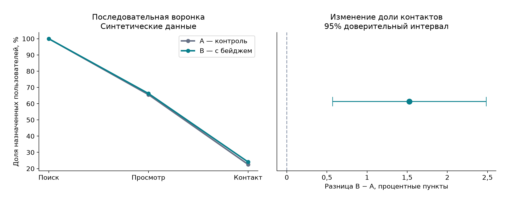

# Влияние информации о скорости ответа продавца на конверсию в контакт

[](https://github.com/TsorievNV/marketplace-product-analytics/actions/workflows/check.yml)

### A/B-тест в сервисе объявлений на синтетических данных

Анализ эксперимента в сервисе объявлений: проверка событий, SQL-витрина,
последовательная воронка, дизайн и анализ эксперимента, визуализация и продуктовое решение.

**Все данные синтетические.**
Генератор задаёт положительный эффект изменения. Анализ показывает, достаточно ли
роста основной метрики для запуска с учётом ограничения по жалобам.



## Результат выполненного запуска

| Показатель | Результат симуляции |
|---|---|
| Пользователи A / B | 14 764 / 15 236 |
| Контакт A → B | 22,58% → 24,10% |
| Разница и 95% ДИ | 1,53 п.п.; [0,57; 2,48] п.п. |
| p-значение проверки размеров групп (SRM) | 0,0064 |
| Верхняя граница прироста жалоб | 0,32 п.п. при пороге 0,30 п.п. |
| Итог | Пока не запускать в рамках симуляции |

## Продуктовый вопрос

Покупатель видит подходящее объявление, но не знает, ответит ли продавец.
Гипотеза: информация о скорости ответа на карточке уменьшит неопределённость
и повысит вероятность контакта в течение 7 дней.
Группа A видит обычную карточку, B — карточку с информацией о скорости ответа.
Эксперимент проводится на синтетическом логе событий.

Контакт — измеримый прокси полезного действия. Он не равен сделке, выручке
или удовлетворённости. Повышение контактов при росте жалоб не считается успехом.

## Что посмотреть за две минуты

1. [Решение и ограничения](marketplace-product-analytics/reports/decision.md) — эффект, доверительный интервал и ограничение по жалобам.
2. [Выполненный ноутбук](marketplace-product-analytics/notebooks/analysis.ipynb) — расчёты и графики.
3. [SQL-витрина](marketplace-product-analytics/sql/user_mart.sql) — CTE, JOIN, оконная функция, защита знаменателя.
4. [Дашборд](marketplace-product-analytics/reports/dashboard.html) — скачать и открыть в браузере; фильтры по устройству и категории.
5. [План эксперимента](marketplace-product-analytics/experiment_plan.json) и [контракт событий](marketplace-product-analytics/docs/data_contract.md).

## Воспроизведение

Python 3.12. Из корня репозитория перейдите в папку проекта:

```bash
cd marketplace-product-analytics
```

Создайте виртуальное окружение:

```bash
python -m venv .venv
```

Активация в Windows PowerShell:

```powershell
.venv\Scripts\Activate.ps1
```

Активация в macOS/Linux:

```bash
source .venv/bin/activate
```

Затем:

```bash
python -m pip install -r requirements-lock.txt
python -m pytest -q
python -m src.pipeline
```

`requirements.txt` описывает допустимые зависимости, `requirements-lock.txt` фиксирует
версии проверенного запуска. Исходные CSV и SQLite не лежат в Git:
они создаются локально командой pipeline. Фиксированное начальное значение генератора
позволяет повторить расчёты и получить те же результаты.
Для интерактивной работы откройте папку в VS Code, выберите Python из `.venv`
и откройте ноутбук через расширения Python и Jupyter.

## Архитектура

```text
experiment_plan.json
        ↓
генератор назначений + исходный лог событий
        ↓
валидация → карантин + дедупликация
        ↓
SQL → пользовательская витрина → воронка
        ↓
A/B-анализ и проверка ограничения по жалобам
        ↓
записка + график + автономный HTML-дашборд
```

## Методология

- 30 000 назначенных пользователей, независимое распределение 1:1; единица анализа — пользователь.
- Основная метрика: доля назначенных пользователей с контактом за 7 дней, подход ITT.
- Расчёт выборки при исходной конверсии 22%, минимальном обнаруживаемом эффекте 1,8 п.п., уровне значимости 5% и мощности 80%.
- Проверка SRM, завершённости окна, разницы долей, p-значения и 95% доверительного интервала.
- Ограничение по жалобам: верхняя односторонняя 95% граница прироста должна быть ниже 0,30 п.п.
  Невозможность показать безопасность приводит к решению отложить запуск, даже если основная метрика выросла.
- Один финальный анализ. Срезы дашборда описательные, без заявлений о значимости сегментов.
- Проверяется разделение основной метрики и последовательной воронки: потеря события просмотра не исключает контакт из основной метрики ITT.

## Проверки

Автотесты проверяют знаменатель при отсутствии событий, границы окна,
ошибочную карточку и потерю предыдущих шагов воронки, конфликтующие дубли,
расчёт эффекта, зависимость выборки от MDE, неопределённость ограничения по жалобам
и частоту ложных срабатываний на 1000 A/A-симуляциях.
GitHub Actions запускает тесты и повторяет анализ на Python 3.12.

## Ограничения

Одна сессия на пользователя и полная наблюдаемость корректного лога упрощают реальность.
Симуляция не проверяет сетевые эффекты продавцов, потери трекинга и переходы между устройствами.
Нельзя выводить реальный бизнес-эффект на основании искусственно заданных закономерностей.
В живом эксперименте необходимы технический аудит логирования и отдельный расчёт мощности
для жалоб. Для хранения событий и построения SQL-витрины используется SQLite.

## Структура

Пути в таблице указаны относительно папки `marketplace-product-analytics/`.

| Путь | Назначение |
|---|---|
| `src/pipeline.py` | Генерация, проверки, анализ и отчёт |
| `sql/user_mart.sql` | Витрина на уровне пользователя |
| `experiment_plan.json` | Зафиксированные до запуска параметры |
| `notebooks/analysis.ipynb` | Выполненный разбор |
| `reports/` | Результаты, записка, график, дашборд |
| `docs/data_contract.md` | Контракт событий и определения |
| `tests/` | Тесты аналитических инвариантов |
