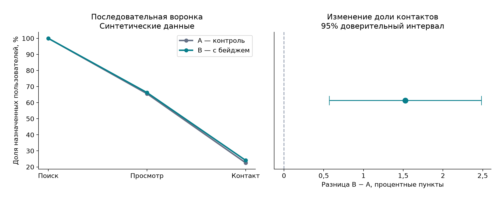

# Анализ эксперимента в сервисе объявлений

**Пока не запускать в рамках симуляции**

Все пользователи и события синтетические; эффект изменения задан генератором.
Решение учитывает рост контактов и допустимый прирост жалоб.

## Решение и доказательства

Основная метрика — доля всех назначенных пользователей с контактом за 7 дней.
Контроль: 22,58%; тест: 24,10%.
Разница: **1,53 п.п.**, относительное изменение 6,76%.
95% ДИ разницы: [0,57 п.п.; 2,48 п.п.]; p-значение = 0.001792.

Жалобы на назначенного пользователя: 0,80% → 0,94%.
Верхняя односторонняя 95% граница прироста: 0,32 п.п..
Допустимый прирост задан до запуска: 0,30 п.п. Проверка ограничения: не пройдена.
Отсутствие значимости жалоб само по себе не доказывает безопасность.

Проверка соотношения размеров групп (SRM): p-значение = 0.0064.
Окна наблюдения всех пользователей завершены: да.
Расчётный объём для основной метрики: 8,554 на группу
(исходная конверсия 22%, минимальный обнаруживаемый эффект 1,8 п.п., уровень значимости 5%,
мощность 80%). Это не отдельный расчёт мощности жалоб.
Если по ограничению недостаточно точности, решение — отложить запуск независимо от основной метрики.

## Качество данных

Строк получено: 58,517; дублей: 1,426;
карантин после дедупликации: 45; принято: 57,046.
Проверены известность пользователя, тип события, время, обязательные идентификаторы
и различия в содержимом событий с одним event_id. Назначения из знаменателя не исключались.
Внесённые дефекты аддитивные. Проверка не обнаруживает события, которые вообще не были отправлены.

## Воронка и продуктовая интерпретация

Воронка требует порядка «поиск → просмотр → контакт» в одной сессии и по одному объявлению.
Основная метрика отдельно считает любой корректный контакт в окне пользователя.
Знаменатель — назначенные пользователи, а не увидевшие бейдж или связавшиеся с продавцом.
Контакт — прокси полезного действия, не сделка и не выручка. Нет данных о продаже,
ответе продавца и удовлетворённости. Нельзя пересчитывать эффект в деньги.
